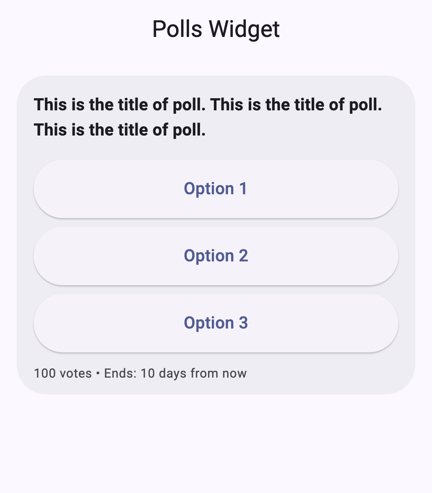
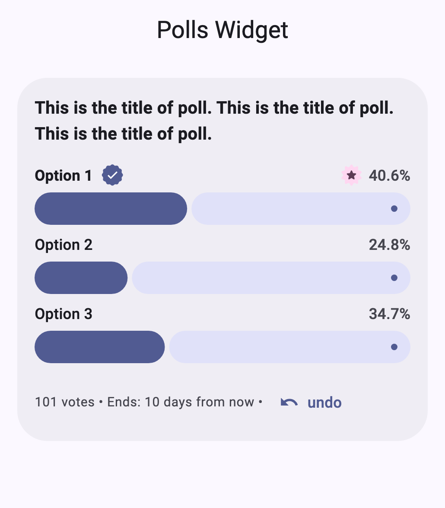
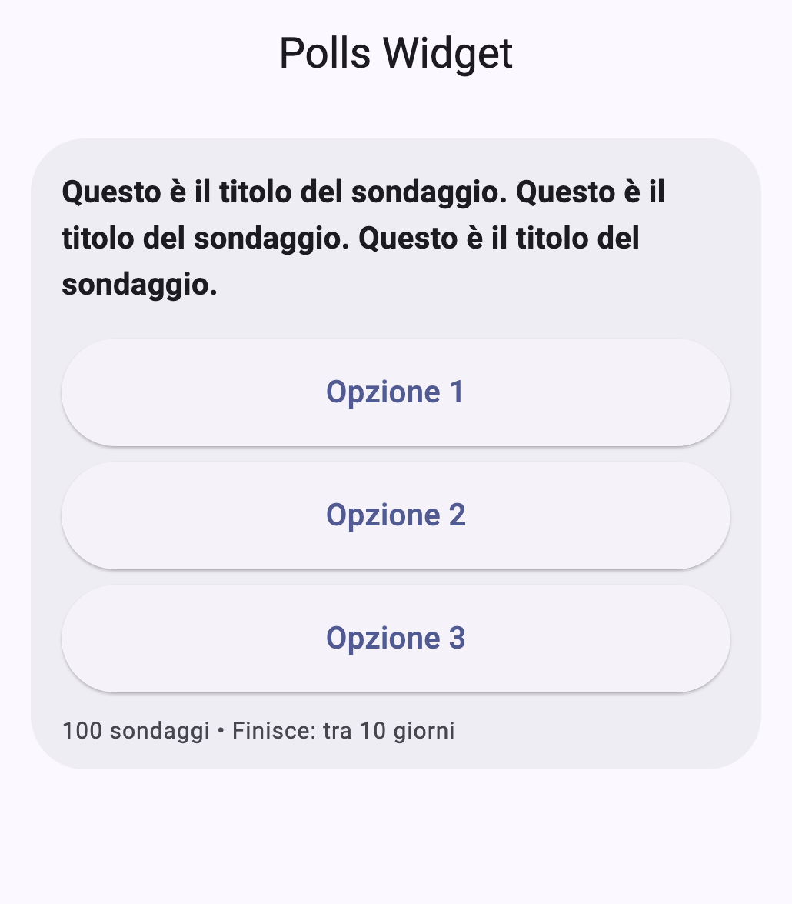
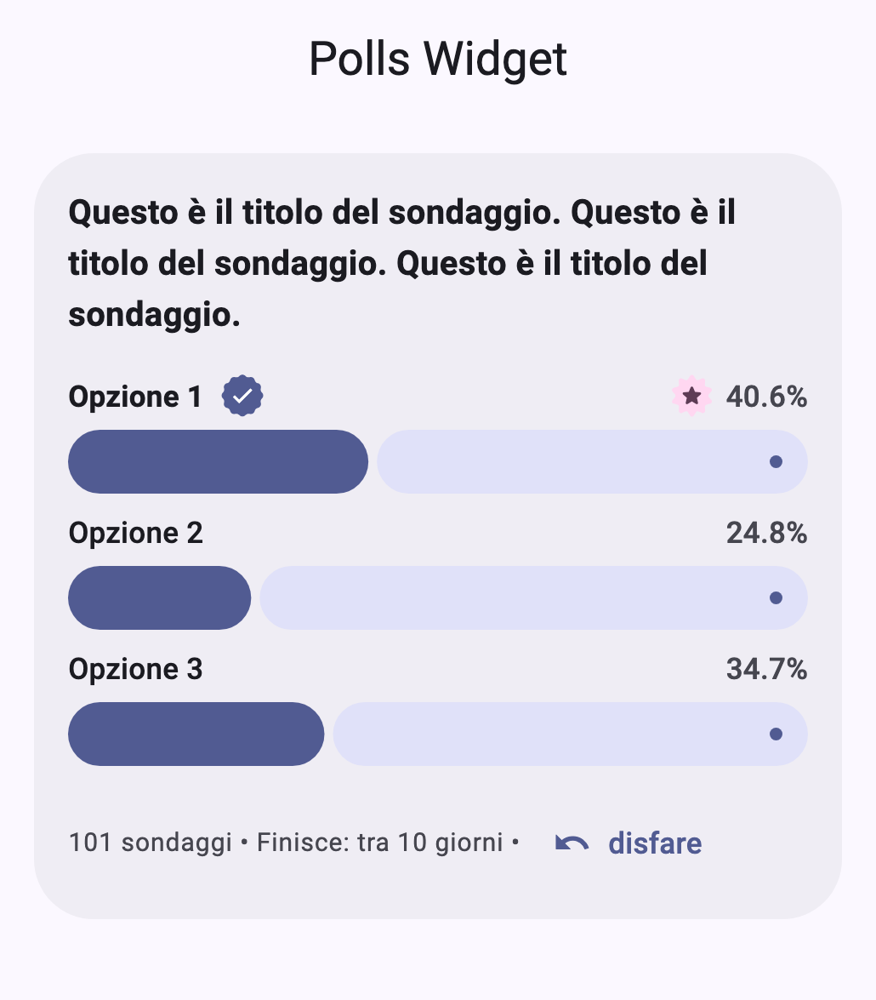

# simple_polls

simple_polls widget is polling widget with language localizations.

> [!NOTE]
> Version 3.0.0 switches to Material 3 Expressive and `material_ui`, with
> breaking changes to `PollStyle` and `PollLocale` — see the
> [CHANGELOG](CHANGELOG.md).

## Example

for full example please view example/main.dart.

```dart
Poll<int>? poll = Poll(
  title: 'This is the title of poll. This is the title of poll. This is the title of poll.',
  endsAt: DateTime.now().toUtc().add(Duration(days: 10)),
  isEditable: true,
  options: <PollOption<int>>[
    PollOption(id: 1, label: 'Option 1', voteCount: 40),
    PollOption(id: 2, label: 'Option 2', voteCount: 25),
    PollOption(id: 3, label: 'Option 3', voteCount: 35),
  ],
);

PollVote<int>? vote;

// SimplePoll is a fully controlled widget: it never mutates poll/vote,
// it only reports the user's intent through onVoteChanged.
SimplePoll<int>(
  poll: poll,
  vote: vote,
  onVoteChanged: (newVote) {
    print('Selected option ids: ${newVote?.selectedOptionIds}');
    setState(() {
      poll = poll.withVoteApplied(previousVote: vote, newVote: newVote);
      vote = newVote;
    });
  },
)
```

Polls use Material 3 Expressive by default. For the 2.x look, pass
`style: PollStyle(variant: StyleVariant.material3)`.

## Screenshots

|  | Options | Results |
| --- | --- | --- |
| English |  |  |
| Italian |  |  |

>NOTE:
>Built-in locales are `PollLocale.en` (default), `.it`, `.fr`, `.es`, `.de`.
>Construct a custom `PollLocale` to add another language or override any label.
>This widget does not translate the poll title/options, they should be translated by the caller.
